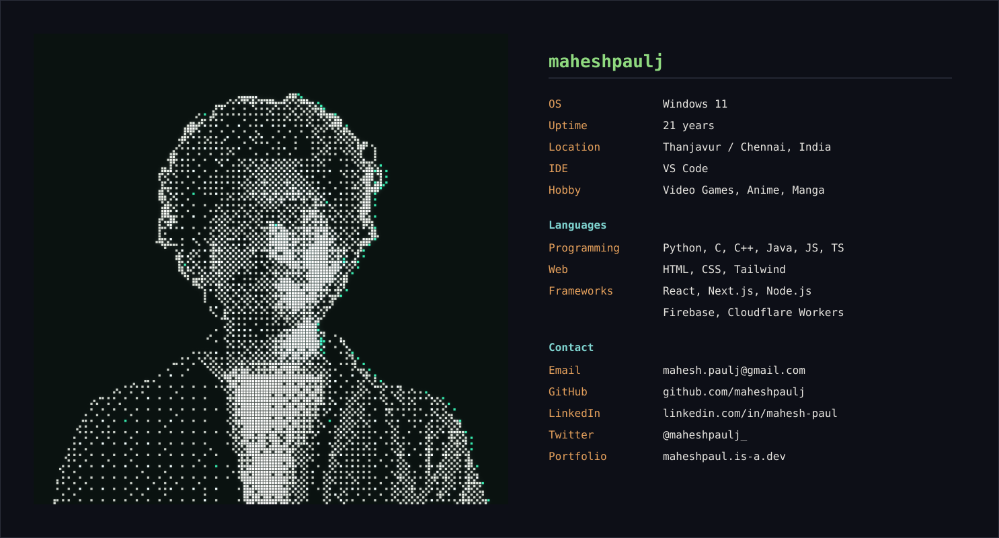

 

<h1>&nbsp; Hi, I'm Mahesh Paul</h1>

**`Computer Science Student @ SRM`**

I'm a tech enthusiast with a passion for software development. Ever since I was young, I've been fascinated by technology — I'm excited to see where this journey takes me, and I can't wait to keep learning and growing as a developer.

 

## ⚒️ Skills

 

## 📊 GitHub Stats

<table>
<tr>
<td valign="top"></td>
<td valign="top"></td>
<td valign="top"></td>
</tr>
</table>

 

## 🏆 GitHub Trophies

 

## 📱 Socials

&nbsp;&nbsp;
&nbsp;&nbsp;
&nbsp;&nbsp;
&nbsp;&nbsp;

 

